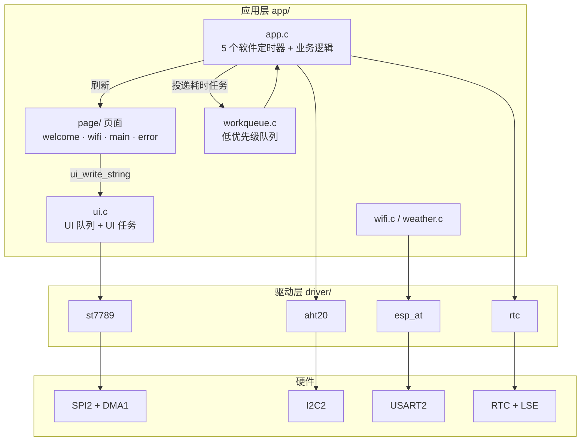

# 智能天气时钟 · STM32F407 + FreeRTOS

<p align="left">
  
  
  
  
  
</p>

一块放在桌上的时钟。上电先连 WiFi，拿不到网络时间就先空着；连上之后屏幕显示**时间日期、室内温湿度、室外天气**，每小时用 SNTP 校一次时，断电再上电只要纽扣电池还在就接着走。

整机跑在 FreeRTOS 上，4 个任务分工：刷屏的只管刷屏，联网的只管联网，读写传感器的活儿全丢给最低优先级的工作队列——这样时间刷新不会被一次 HTTP 超时拖成几十秒一卡。

---

## 目录

- [做成什么样](#做成什么样)
- [功能](#功能)
- [技术要点](#技术要点)
- [系统架构](#系统架构)
- [硬件与接线](#硬件与接线)
- [跑起来](#跑起来)
- [目录结构](#目录结构)
- [已知问题 / TODO](#已知问题--todo)
- [许可与致谢](#许可与致谢)

---

## 做成什么样

```
┌──────────────────────────────────┐  240 × 320 竖屏
│ ┌──────────────────────────────┐ │
│ │ ▮▮  School_Rumble            │ │  WiFi 图标 + 当前 SSID
│ │                              │ │
│ │     14:07                    │ │  76 号字，冒号隔秒闪烁
│ │  2026/10/22 星期四            │ │  20 号字
│ └──────────────────────────────┘ │  白色卡片
│ ┌────────────┐ ┌───────────────┐ │
│ │ 室内环境    │ │      25 C     │ │
│ │  26.4 C    │ │    [云] 武汉   │ │
│ │   58.2%    │ │               │ │
│ └────────────┘ └───────────────┘ │  蓝色卡片 / 橙色卡片
└──────────────────────────────────┘
```

- 时间字号 76，ASCII 字宽 = 字号/2 = 38px，`14:07` 正好 152px，塞进 224px 宽的卡片里不空也不挤
- 冒号"闪烁"是把 `:` 隔秒换成空格——两者字宽相同，所以整行不会左右抖一下再回来
- 每块内容固定坐标、带背景色重画矩形，**不清屏**，所以既不闪也没有滚动感

> 实拍图和演示 GIF 待补，放到 `docs/screenshot/` 后把上面这段换成图片即可。

---

## 功能

- **时间日期**：片内 RTC，LSE 32.768kHz 晶振，断电靠 VBAT 维持
- **网络校时**：`AT+CIPSNTPTIME` 取网络时间写回 RTC，一小时一次；失败自动改 1 秒重试，成功后拉回 1 小时
- **室内温湿度**：AHT20，I2C 读取，3 秒一次
- **室外天气**：心知天气 API，解析城市、天气文字、温度、天气代码，映射成图标，1 分钟一次
- **WiFi 状态**：显示 SSID，后台 5 秒查一次信道和 RSSI
- **开机流程**：欢迎页 → 配网页（显示连接进度）→ 主界面；任一步失败进错误页并停在那，不静默失败
- **调试**：USART1 115200 打印全流程日志，栈溢出 / malloc 失败 / assert 都会打出是哪个任务炸的

---

## 技术要点

这部分是真花时间的地方，也是被追问时最经得起问的几处：

| 问题 | 做法 | 效果 |
|---|---|---|
| 240×320 的 RGB565 整屏要 150KB，F407VET6 只有 128KB SRAM | 纯色填充时**清掉 `DMA_SxCR.MINC`**，让 DMA 反复搬同一个颜色变量 | 不要整屏缓冲，填充耗时只受 SPI 带宽限制 |
| 定时器回调里不能阻塞，否则时间刷新被拖慢 | 回调只做"读 RTC + 拼字符串 + 发队列"，需要等的活儿投给低优先级 `workqueue` | 时间稳定 1 秒刷新，不受网络超时影响 |
| 队列里传 `char *`，指向的是页面函数栈上的局部数组 | `ui_write_string()` 内部 `pvPortMalloc` 深拷贝，UI 任务用完 `vPortFree` | 根除野指针，页面函数可以随便返回 |
| `RSF` 只保证单个寄存器一致，日期和时间是两次 APB 读 | `rtc_get_time()` 连续读两遍比对，不一致重读；写时间写完读回校验 | 23:59:59 跨天那一刻不会读出"新日期 + 旧时间" |
| 只为 5 个字段引 cJSON 不划算 | `strstr` 逐层定位 + `sscanf` 带宽度限制提取 | 省约 10KB Flash 和全部动态分配 |
| 中文字库动辄几 MB | 自己写 `convert_chinese_font.py`，TTF 渲染成 1bpp，**只保留用到的字** | 字库压到几十 KB，字号随时可换 |

几个具体实现：

**纯色填充省内存**

```c
/* 内存地址不自增：DMA 每次都搬同一个 color 变量 */
DMA_InitStruct.DMA_MemoryInc = DMA_MemoryInc_Disable;
DMA_InitStruct.DMA_BufferSize = width * height;
```

代价是填充只能按行发、不能一次跨行连续，换来的是零额外内存占用。**文字渲染反过来**：先把一小块区域展开到 `static` 缓冲，再开 `MINC` 发出去。

**RTC 双读**

```c
do {
    _rtc_get_time_once(&t1);
    _rtc_get_time_once(&t2);
} while (memcmp(&t1, &t2, sizeof(t1)) != 0);
```

**JSON 定点提取**

```c
const char *now  = strstr(response, "\"now\":");
const char *text = strstr(now, "\"text\":");
sscanf(text, "\"text\": \"%15[^\"]\"", info->weather);   /* %15 限宽防溢出 */
```

---

## 系统架构



**只向下调用**：`page/` 不认识任何驱动，只往 UI 队列发消息；`ui.c` 只调 `st7789_*`；驱动只碰寄存器。换一块屏只改 `st7789.c`，页面一行不动。

### 任务划分

| 任务 | 优先级 | 栈 | 干什么 |
|---|---|---|---|
| Timer Service | 9 | `configTIMER_TASK_STACK_DEPTH` | 跑软件定时器回调，必须准点 |
| `init` | 9 | 1024 | 板级初始化 → 欢迎页 → 配网 → 主页 → 建定时器，完成后自删 |
| `ui` | 8 | 1024 | 独占 SPI：取队列 → 查字模 → 转 RGB565 → DMA 刷屏 |
| `workqueue` | 5 | 1024 | 串行干慢活：I2C 读、AT 指令、HTTP 请求 |

### 一条数据的路径

```
定时器(1s) → rtc_get_time() 双读校验 → snprintf 格式化 → ui_write_string()
             → pvPortMalloc 深拷贝入队 → ui 任务(prio 8) 取队列
             → 逐字符查字模 → 1bpp 展开成 RGB565 → 0x2A/0x2B 设窗口
             → 0x2C 写显存 → DMA 搬运 → 等传输完成信号量 → vPortFree
```

时间、室内、室外三条链路走的是同一套骨架，只是数据源和坐标不同。

---

## 硬件与接线

| 器件 | 型号 | 备注 |
|---|---|---|
| 主控 | STM32F407VET6 最小系统板 | 512KB Flash / 192KB SRAM，168MHz |
| 屏幕 | ST7789 240×320 SPI 屏 | 8 针 |
| 温湿度 | AHT20 | I2C，地址 `0x38` |
| 无线 | ESP8266 / ESP32，烧 ESP-AT 固件 | 115200 8N1 |
| 晶振 | 32.768kHz | 接 PC14 / PC15 |
| 电池 | CR1220 接 VBAT（可选） | 不接则上电时间从 2000/01/01 起 |

| 外设 | 引脚 |
|---|---|
| ST7789 | SCK `PB13` · MOSI `PC3` · MISO `PC2` · CS `PE2` · RES `PE3` · DC `PE4` · BL `PE5` |
| AHT20 | SCL `PB10` · SDA `PB11`（I2C2） |
| ESP-AT | TX `PA2` · RX `PA3`（USART2） |
| 调试串口 | TX `PA9` · RX `PA10`（USART1，115200，`printf` 重定向） |
| 按键 | `PA0` · `PC4` · `PC5`（驱动已写，业务层暂未用） |

SPI2 = APB1(42MHz) / 4 ≈ 10.5MHz，DMA 走 **DMA1 Stream4 Channel0**。

---

## 跑起来

**1. 环境**：Keil MDK 5（ARMCC 5）+ `Keil.STM32F4xx_DFP` 器件包；串口助手；Python 3（只有换字库时才要）。

**2. 改两个地方**

`app/wifi.h` —— 只支持 2.4GHz，5G 热点连不上：

```c
#define WIFI_SSID   "你的WiFi名称"
#define WIFI_PASSWD "你的WiFi密码"
```

`app/app.h` —— 去 [心知天气](https://www.seniverse.com/) 注册免费版换自己的 key：

```c
#define WEATHER_URL "https://api.seniverse.com/v3/weather/now.json?key=你的KEY&location=wuhan&language=en&unit=c"
```

**3. 编译烧录**：打开 `mdk/stm32f407.uvprojx` → `Build`(F7) → `Download`(F8)。编译宏：`STM32F40_41xxx, USE_STDPERIPH_DRIVER, HSE_VALUE=8000000`。新增源文件要手动加进对应分组。

**4. 看日志**（USART1，115200）：

```
[SYS] Build Date: Oct 22 2026 14:07:00
[AT] inited
[WIFI] Connected
[WIFI] SSID: xxx, BSSID: ..., Channel: 6, RSSI: -52
[SNTP] inited
```

**5. 换字库**（可选）：`python tools/convert_chinese_font.py`，只保留实际用到的汉字，否则整字库几 MB 直接撑爆 Flash。

> ⚠️ 源码是 **GBK** 编码（Keil 默认）。VSCode 里看到乱码不是文件坏了，把编码切到 `GB2312/GBK` 就好。想统一成 UTF-8，记得同步改 Keil 的 `Edit → Configuration → Encoding`。

---

## 目录结构

```
WeatherClock-main/
├── app/                  应用层
│   ├── main.c            入口：低层初始化 → workqueue → init 任务 → 启动调度器
│   ├── app.c             5 个软件定时器 + 各模块刷新逻辑
│   ├── board.c           总线时钟、LSE、printf 重定向、断言钩子
│   ├── ui.c              UI 队列与 UI 任务
│   ├── workqueue.c       慢操作串行化
│   ├── wifi.c            配网、SNTP、WiFi 信息查询
│   ├── weather.c         天气 JSON 解析
│   ├── page/             welcome / wifi / main / error 四个页面
│   ├── font/             1bpp 字库（16/20/24/32/76 号）
│   ├── image/            天气图标、WiFi 图标、温度计、Logo
│   └── ota/              App 侧 OTA 客户端（未加入默认编译）
├── driver/               st7789 · aht20 · esp_at · rtc · tim_delay · console
│                         key / led / bl24c512（已实现，暂未接入业务）
├── bootloader/           双区 OTA Bootloader（独立工程，未加入默认编译）
├── firmware/             CMSIS + STM32F4 标准外设库
├── third_lib/freertos/   FreeRTOS 内核与移植层
├── mdk/                  Keil 工程
├── tools/                字库转换、OTA 镜像打包脚本
├── resources/            图标原图、天气代码说明
└── docs/                 文档与图片
```

---

## 已知问题 / TODO

当着自己的账本记，不藏：

- [ ] `st7789_write_chinese()` 里 `strncpy(ch, str, 2)` 后没补 `'\0'`，靠栈上恰好为 0，应显式 `ch[2] = '\0'`
- [ ] `main_page_redraw_inner_humidity()` 用的是 `char str[3]`，湿度到 `100` 会溢出且未初始化，应改 `char str[8]`
- [ ] WiFi 凭据是编译期宏，想做首次配网写 EEPROM、以后自动读
- [ ] 每次复位都重配 `RTC_PRER`，应按规范往 `RTC_BKP0R` 写魔数判断是否已初始化
- [ ] `key` / `led` / `bl24c512` 三个驱动写完了但没接业务
- [ ] `bootloader/` 和 `app/ota/` 代码就绪，还没加进 Keil 工程分组（缺 `app_updates_suspend()` / `app_updates_resume()` 钩子）
- [ ] UI 整块重绘，没做脏矩形合并，也没过渡动效

---

## 许可与致谢

本项目基于 B 站 [梅花嵌入式](https://www.bilibili.com/video/BV1tfL1zeEQN) 开源的天气时钟工程二次开发，遵循 **GNU GPL v3.0**，详见 [LICENSE](LICENSE)。分发衍生作品时请同样开源并保留原作者版权声明。

- [梅花嵌入式](https://www.bilibili.com/video/BV1tfL1zeEQN) —— 原始工程与教学视频
- [FreeRTOS](https://www.freertos.org/) —— 实时内核
- [心知天气](https://www.seniverse.com/) —— 天气数据 API
- STM32F4 标准外设库、CMSIS —— 底层支持
